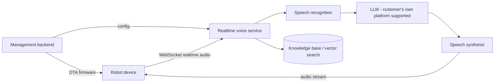

# Robot AI Dialogue Backend
### On-Premise Deployment for Companion · Education · Service Robots

> **This repository is a public technical overview.** It documents architecture, capabilities and
> deployment requirements. The product is **commercially licensed and delivered on-premise**;
> **source code is not published here.**

---

## In one line

The complete server side that makes a robot **listen, speak, answer and stay manageable** —
deployed inside the customer's own servers or intranet:
**data never leaves the customer's environment, the model layer can be the customer's own platform,
and deployed devices can be updated remotely.**

---

## 1. Capabilities

| Capability | Notes |
|---|---|
| **Realtime voice dialogue** | Full-duplex pipeline: ASR → LLM → TTS, speaking while streaming |
| **Barge-in / echo handling** | User can interrupt mid-playback and switch topics (coordinated with the device side) |
| **Multilingual** | Language coverage depends on the selected speech models; switchable per target market (Chinese / English / Korean, etc.) |
| **Knowledge-base Q&A** | Retrieval-augmented answering built from the customer's own corpus, configured during implementation |
| **Tool calling** | Weather, news, time, device control and similar functions; availability depends on whether the selected LLM supports function calling |
| **Device & firmware management** | Device registration and authentication, OTA firmware updates, version and activation management |
| **Per-device configuration** | Different roles, voices, prompts and knowledge bases delivered to different devices / batches |
| **Operations console** | Web console plus mobile client for devices, agents, models, voices and user permissions |
| **Dialogue retention** | Optional retention of dialogue text and audio, configured to the customer's compliance policy |

---

## 2. Architecture (illustrative)

```
                        Robot device
                             |  WebSocket realtime audio (Opus)
                             v
        +------------ Realtime voice service ------------+
        |   ASR  ->  LLM  ->  TTS                        |
        |        +-- knowledge-base retrieval            |
        +------------------+----------------------------+
                           |  audio stream back to device
                           v
                        Robot device

        +------------ Management & operations -----------+
        |  device registration / auth - OTA firmware -   |
        |  agents & voices - model config - knowledge -  |
        |  users & permissions                           |
        +------+--------------------------+--------------+
           Web console                Mobile client
```



**Four subsystems**: realtime voice service, management backend, web console, mobile client.

---

## 3. Deployment requirements

| Item | Requirement |
|---|---|
| Form | On-premise (customer servers / intranet / customer cloud) |
| CPU architecture | **x86_64** |
| OS | **Ubuntu 22.04 LTS** (other distributions subject to assessment) |
| Privileges | **root or equivalent** (including service auto-start) |
| Containers | **Docker** available (some components are containerised) |
| Network | Outbound access to the selected model / speech services — or none, when the customer's own platform is used |
| Server sizing | Calculated from device count and concurrency; provided by us at proposal stage |
| Domain & certificate | Provided by the customer; **WSS is mandatory** — without a valid certificate devices cannot connect |
| Security baseline | Delivered with **ports narrowed and device authentication enabled** by default |

---

## 4. What makes it different: bring your own model (BYO-Model)

The service layer is decoupled from the model layer. It can be pointed at **the customer's own
MaaS / LLM platform**:

- **No data leaves the environment** — dialogue and voice data stay inside the customer's systems
- **Compute cost stays with the customer** — model usage is billed by the customer's own platform; we do not resell compute
- **Wide model choice** — anything exposing an OpenAI-compatible API with function calling can be configured
- **No lock-in** — models and price lists evolve; switching is a configuration change, not a code change

> Designed and verified against a domestic MaaS platform scenario; the exact platform and models depend on the project.

---

## 5. Scope

| Included | Not included |
|---|---|
| On-premise deployment and implementation | Servers / cloud resources, domain and certificate |
| LLM and speech integration, joint testing and acceptance | Model usage fees (billed by the customer's platform) |
| Knowledge-base building and import | Third-party content sources such as online music |
| Device-side integration and OTA endpoint switch-over | Hardware and accessories |
| Deployment / operations / API documentation and training | New features and new requirements (change request) |
| Defect fixes, remote support, version upgrades (no new features) | Customer's own environment, network or hardware failures |

---

## 6. Engineering practice

Versioning conventions, release process, deployment traceability and per-site configuration
manifests ship with the delivery package. The package separates **our code** from **third-party
components** and includes a third-party licence inventory with the corresponding notices.

---

## 7. FAQ

**Is this open source?**
No. This repository publishes architecture and documentation only; the product is commercially licensed and delivered on-premise.

**Does data leave the network?**
No, by default. When the customer's own model platform is used, dialogue and voice data never leave the customer's environment.

**Can it use our own LLM?**
Yes — as long as it exposes an OpenAI-compatible API with function calling.

**Who is responsible for compliance and certification?**
After delivery, the obligations of the party providing services to end users rest with the **service provider (the customer)**; we supply technical documentation and cooperation. Where personal data or minors' data is involved, retention and deletion policies follow the customer's jurisdiction.

**Can we get the source code?**
Yes — source delivery is a separate option.

---

## 8. Contact

Technical enquiries and on-premise deployment discussions: **myron.z.zhang # gmail.com**
(replace `#` with `@` — written this way to defeat address harvesters while staying obvious to humans)

You are also welcome to open an issue or message us through this repository.

**Our hardware product lines have a separate product site** — education & companion robots,
service & inspection robots, and mobile base platforms, with figures and OEM/ODM notes:
[robots.softgear.work](https://robots.softgear.work)

---

*This repository is a technical overview and does not constitute a product commitment; actual specifications and scope are governed by the project proposal and contract.*
*Some components are developed on top of open-source projects; the corresponding licences and notices ship with the delivery package.*

**Maintained by** the AI Server Team, Yongyida Research Institute
