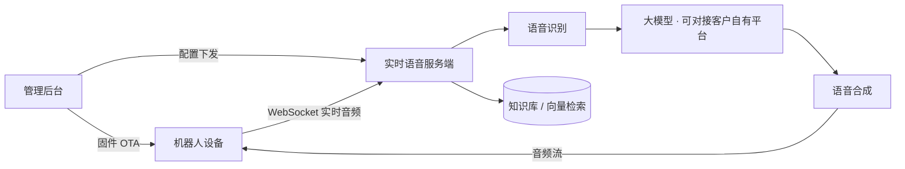

# 机器人 AI 对话服务端（私有化版）
### Robot AI Dialogue Backend · On-Premise

> **本仓为对外技术说明**：公开架构、能力与部署要求。
> 产品为**商业授权 · 私有化交付**，**源码不在本仓公开**。

面向陪伴、教育、服务机器人厂商与行业客户，提供可**私有化部署**的实时语音 AI 对话服务端。

---

## 一句话

把机器人"**能听、能说、能答、能被管理**"的整套服务端，部署进客户自己的服务器或内网：
**数据不出域，模型可对接客户自有平台，设备可远程升级与配置。**

---

## 1. 能力矩阵

| 能力 | 说明 |
|---|---|
| **实时语音对话** | 全双工链路：语音识别 → 大模型 → 语音合成，边说边播 |
| **打断与回声处理** | 支持用户中途打断、停止播报并切换话题（与设备侧协同） |
| **多语种** | 语种范围取决于所选语音模型能力，可按目标市场切换（中／英／韩等） |
| **知识库问答** | 基于检索增强（RAG）的问答，按客户语料构建，实施阶段配置 |
| **工具调用** | 天气、新闻、时间、设备控制等函数能力；可用性取决于所选大模型是否支持 function calling |
| **设备与固件管理** | 设备注册与鉴权、固件远程升级（OTA）、版本与激活管理 |
| **按设备下发配置** | 不同设备／批次下发差异化角色、音色、提示词与知识库 |
| **运营后台** | 设备、智能体、模型、音色、用户权限的 Web 控制台 ＋ 移动端 |
| **对话数据留存** | 对话文本与音频可按需留档，留存策略依客户合规要求设定 |

---

## 2. 系统架构（示意，已脱敏）

```
                        机器人设备
                             │  WebSocket 实时音频（Opus）
                             ▼
        ┌──────────── 实时语音服务端 ────────────┐
        │  语音识别(ASR) → 大模型(LLM) → 语音合成(TTS)  │
        │        └── 知识库检索（按客户语料构建）        │
        └───────────────────┬───────────────────┘
                            │  音频流回推（边说边播 · 可打断）
                            ▼
                        机器人设备

        ┌──────────── 管理后台与运营侧 ────────────┐
        │ 设备注册/鉴权 · 固件 OTA · 智能体与音色 ·   │
        │ 模型配置 · 知识库 · 用户与权限             │
        └──────┬───────────────────────┬───────────┘
            Web 控制台                移动端
```



**四个子系统**：实时语音服务端 · 管理后台 · Web 控制台 · 移动端。

---

## 3. 部署形态与最低要求

| 项 | 要求 |
|---|---|
| 部署形态 | 私有化部署（客户自有服务器 / 内网 / 客户云） |
| CPU 架构 | **x86_64** |
| 操作系统 | **Ubuntu 22.04 LTS**（其他发行版需评估） |
| 权限 | **root 或等效权限**（含服务开机自启） |
| 容器 | 支持 **Docker**（知识库等组件为容器化部署） |
| 网络 | 需访问所选大模型／语音服务；若走客户自有平台，可为纯内网 |
| 服务器规格 | 按设备数与并发核算，由我方在方案阶段给出 |
| 域名与证书 | 由客户申请；**WSS 必需**——证书未就绪会导致设备无法接入 |
| 安全基线 | 交付默认**收敛对外端口 ＋ 开启设备鉴权** |

---

## 4. 差异化：把模型选择权交回客户（BYO-Model）

服务端与模型层解耦，可对接**客户已有的国产 MaaS／大模型平台**：

- **数据不出域** —— 对话与语音数据全程留在客户体系内
- **算力成本自持** —— 模型调用费由客户平台结算，我方不转售算力
- **可选模型面广** —— 具备 OpenAI 兼容接口与函数调用能力即可配置合入
- **不锁死** —— 平台模型与价目表迭代时，以配置方式更换，无需改代码

> 已在国产 MaaS 平台场景下完成方案设计与接入验证方法；具体平台与型号以项目评估为准。

---

## 5. 交付范围

| 含 | 不含 |
|---|---|
| 私有化部署与实施 | 服务器／云资源、域名与证书 |
| 大模型与语音接入、联调与验收 | 模型调用费（由客户平台结算） |
| 知识库构建与导入 | 在线音乐等第三方内容源 |
| 设备端联调、OTA 地址切换 | 硬件与配件 |
| 部署／运维／接口文档与培训 | 新功能与新需求（走变更） |
| 缺陷修复、远程支持、版本升级（不含新功能） | 客户自身环境／网络／硬件故障 |

---

## 6. 工程规范

版本号规范、发布流程、部署留痕与差异化配置清单随交付包提供。
交付包明确区分**我方代码 / 第三方组件**，并附《第三方组件与许可清单》（含相应许可证与声明）。

---

## 7. 常见问题

**是开源项目吗？**
不是。本仓仅公开架构与文档；产品为商业授权、私有化交付。

**数据会出公网吗？**
默认不出域。若使用客户自有模型平台，对话与语音数据全程留在客户体系内。

**能对接我们自己的大模型吗？**
可以，只要具备 OpenAI 兼容接口与函数调用能力。

**出口认证／合规由谁负责？**
交付物交付后，面向最终用户提供服务的合规义务由**服务提供方（客户）**承担，我方提供技术资料与配合。
涉及个人信息与未成年人数据时，按客户属地要求设定留存与删除策略。

**能提供源码吗？**
可以，源码交付为独立选项。

---

## 8. 合作与联系

技术方案与私有化部署交流：**myron.zhang # foxmail.com**
（发信时把 `#` 换成 `@`；这样写是为了防邮件爬虫，同时保证真人一眼能看懂）

也可以直接在本仓提 Issue 或站内私信留言。

**硬件产品线另有产品页**：教育陪伴、服务巡检、移动底盘三类整机与模组的参数与 OEM/ODM 说明 ——
[robots.softgear.work](https://robots.softgear.work)（英文，面向海外进口商与品牌方）

---

*本仓内容为对外技术说明，不构成产品承诺；具体参数与服务范围以项目方案与合同为准。*
*部分组件基于开源项目二次开发，相应许可证与声明随交付包提供。*

**维护方**：勇艺达研究院 · AI 服务端团队
